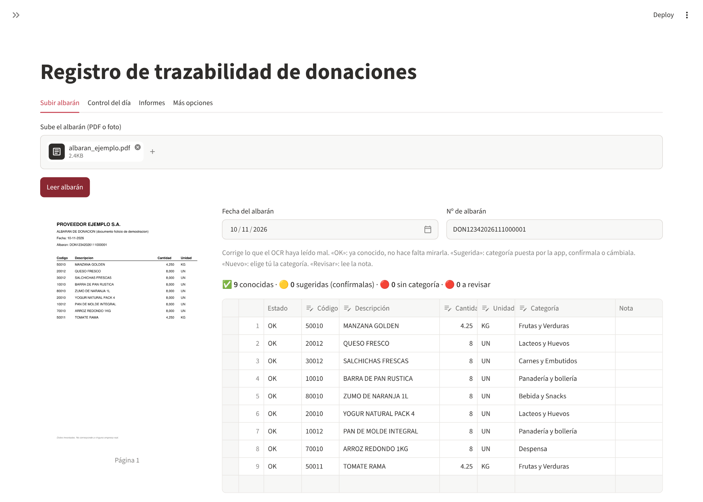
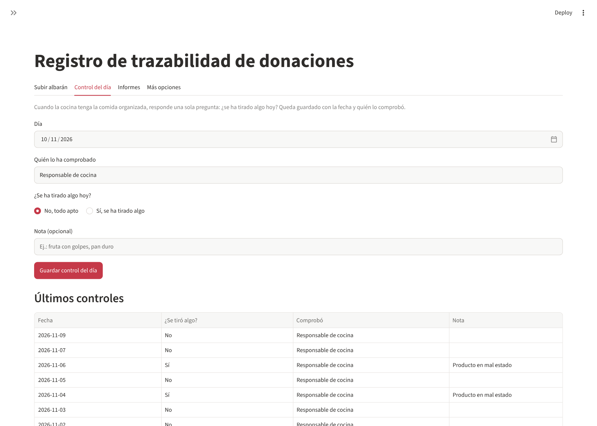
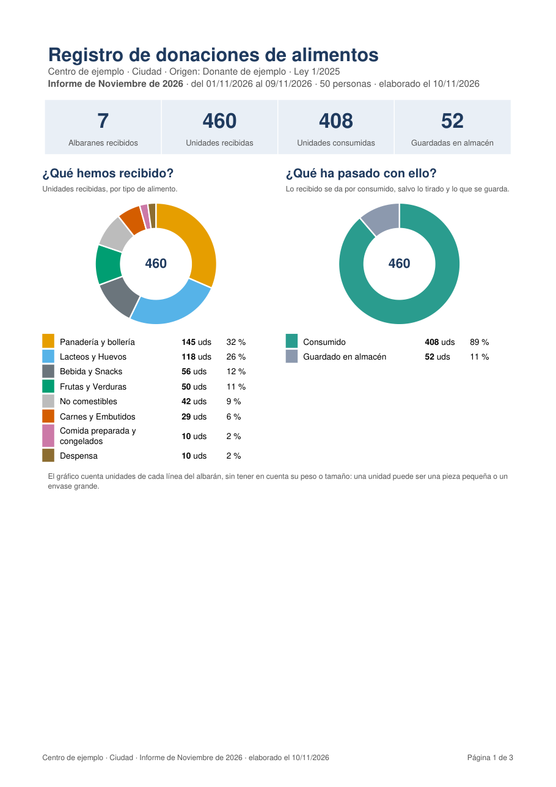
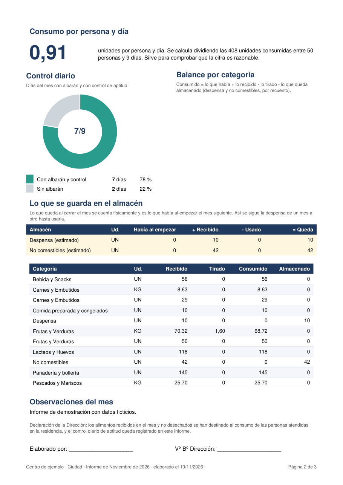
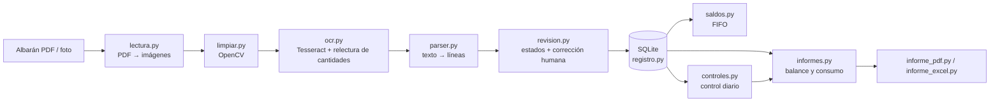

# 🥫 Food Donation Traceability

**ES** · Aplicación local que convierte los albaranes escaneados de una donación diaria de alimentos en un **registro de trazabilidad auditable** (entradas, control diario, consumo calculado e informes en PDF).
**EN** · Local app that turns scanned delivery notes of daily food donations into an **auditable traceability register** (intake, daily check, calculated consumption and PDF reports).


> **Aviso / Disclaimer** — Proyecto MVP de portafolio. No es asesoramiento legal; el formato de un registro oficial debe confirmarse con la autoridad competente. Todos los datos, nombres y capturas de este repositorio son **ficticios**.
> MVP portfolio project. Not legal advice. All data, names and screenshots in this repository are **fictitious**.

---

## 💼 Caso real · Real-world use

Este proyecto nace de una necesidad real y **se aplica en un caso real en la empresa donde trabajo actualmente**, un centro de atención a personas que recibe donaciones diarias de alimentos y debe justificarlas ante inspección. Por confidencialidad, el repositorio no incluye ningún dato, nombre ni documento real: solo el código y datos de demostración ficticios.

*It was born from a real need and **is used in a real case at the company where I currently work**: a care centre that receives daily food donations and must justify them in inspections. For confidentiality, this repository contains no real data, names or documents, only code and fictitious demo data.*

---

## 🎯 El problema · The problem

Un centro que recibe alimentos donados cada día debe poder demostrar, ante una inspección, **qué entró, cuándo y qué pasó con ello**. Hacerlo a mano con hojas de cálculo es lento y propenso a errores: cada albarán tiene decenas de líneas y llega en papel o PDF escaneado.

*A site receiving donated food every day must be able to prove, in an inspection, what came in, when, and what happened to it. Doing it by hand in spreadsheets is slow and error-prone.*

## ✨ Qué hace (MVP) · Features

| | |
|---|---|
| 📄 **Lectura de albaranes** | PDF o foto → imagen limpia (enderezado, contraste) → OCR con Tesseract → líneas `código · descripción · cantidad · unidad` |
| 🔎 **Revisión humana** | Nada se descarta en silencio: cada línea se marca *OK / Sugerida / Nueva / Revisar* y se corrige antes de guardar |
| 🧮 **Validaciones** | El número de albarán lleva la fecha dentro y debe coincidir; duplicados rechazados; cantidades implausibles avisadas |
| 🗄️ **Registro en SQLite** | Guardado atómico (todo o nada), catálogo de productos con categorías, PDF original archivado por mes |
| ✅ **Control del día** | Una pregunta diaria («¿se ha tirado algo?») con responsable, nota y fecha |
| 📦 **Existencias FIFO** | Reparto «el primero que entra es el primero que sale» por categoría y unidad; avisos de productos antiguos |
| 📊 **Informes** | PDF mensual (2 hojas) y semanal (1 hoja) con gráficos de anillo, anexo con todas las líneas y Excel |
| 🛡️ **Honestidad de datos** | El consumo se **calcula** (`inicio + recibido − desechado − almacenado`) y el informe lo dice; nunca inventa datos |

## 🖼️ Capturas · Screenshots

*(datos de demostración generados con `scripts/crear_datos_demo.py`)*

**1 · Revisión del albarán leído por OCR**


**2 · Control diario**


**3 · Informe mensual en PDF**

<p>
  
  
</p>

## 🧱 Tecnologías · Tech stack

| Capa | Tecnología |
|---|---|
| Lenguaje | Python 3.11+ |
| Interfaz | Streamlit (+ Altair) |
| OCR / imagen | Tesseract (`pytesseract`), OpenCV, Pillow, PyMuPDF |
| Datos y validación | SQLite, pydantic v2, pandas |
| Informes | ReportLab (PDF vectorial), openpyxl (Excel) |
| Calidad | pytest, Hypothesis (property-based), Ruff, Streamlit `AppTest` |

## 🏗️ Arquitectura · Architecture



Principio de diseño: **el núcleo son funciones puras** (parser, FIFO, balance) sin base de datos ni pantalla, para probarlas a fondo; la UI y SQLite son capas finas por fuera.

### Estructura de carpetas

```
.
├── src/trazabilidad/
│   ├── app.py            # interfaz Streamlit (pestañas)
│   ├── lectura.py        # PDF/foto → imágenes
│   ├── limpiar.py        # preprocesado de imagen
│   ├── ocr.py            # Tesseract + reconstrucción de filas por columnas
│   ├── parser.py         # texto OCR → albarán con líneas validadas
│   ├── revision.py       # estados de línea y corrección antes de guardar
│   ├── registro.py       # esquema SQLite y guardado atómico
│   ├── catalogo.py · cargar_catalogo.py · categorizar.py · productos.py
│   ├── saldos.py         # existencias FIFO y avisos
│   ├── controles.py      # control diario y recuentos
│   ├── informes.py       # balance, consumo e incidencias (funciones puras)
│   ├── informe_pdf.py · informe_excel.py · graficos.py
│   ├── archivo.py · servidor.py   # archivo de PDFs y copia opcional a carpeta de red
│   └── config.py         # nombre del centro y del donante (variables de entorno)
├── tests/                # ~200 pruebas (pytest + Hypothesis + AppTest)
├── scripts/crear_datos_demo.py    # datos ficticios + albarán de ejemplo
├── docs/img/             # capturas del README
├── requirements*.txt · pyproject.toml · LICENSE
```

## 🚀 Probarlo · Quick start

Requisitos: Python 3.11+ y [Tesseract](https://github.com/tesseract-ocr/tesseract) con el idioma español.

```bash
git clone https://github.com/freddyjmc/food-donation-traceability.git
cd food-donation-traceability
python -m venv .venv
source .venv/bin/activate          # Windows: .venv\Scripts\Activate.ps1
pip install -r requirements-dev.txt
pip install -e .

python scripts/crear_datos_demo.py          # crea ./datos_demo (datos ficticios)
TRAZABILIDAD_DATOS=datos_demo streamlit run src/trazabilidad/app.py
```

En Windows PowerShell: `$env:TRAZABILIDAD_DATOS="datos_demo"; streamlit run src/trazabilidad/app.py`.
Sube `datos_demo/albaran_ejemplo.pdf` en la pestaña **Subir albarán** para ver el flujo completo.

Configuración opcional (sin tocar código): `TRAZABILIDAD_CENTRO`, `TRAZABILIDAD_ORIGEN` (nombres que salen en los informes) y `TRAZABILIDAD_DATOS` (carpeta de datos). No hay claves ni servicios externos: **todo funciona en local**.

## 🧪 Tests

```bash
pytest            # ~200 pruebas rápidas
pytest -m ocr     # pruebas lentas con Tesseract
ruff check .
```

## ⚠️ Limitaciones conocidas · Known limitations

- El OCR puede equivocarse (sobre todo en dígitos sueltos y escaneos torcidos): por eso existe la pantalla de revisión y **no se guarda nada sin confirmar**.
- Un solo perfil y un solo formato de albarán (MVP).
- El consumo es un cálculo, no una medición.
- Sin autenticación de usuarios ni registro de auditoría de cambios.

## 🗺️ Roadmap

- [ ] **Multiperfil** (varios centros/usuarios, cada uno con sus datos y ajustes)
- [ ] **Varios proveedores** con plantillas de albarán configurables
- [ ] **Docker** (imagen con Tesseract incluido) y `docker compose`
- [ ] Autenticación y **registro de auditoría** (quién cambió qué y cuándo)
- [ ] **Cierre de mes** con bloqueo de datos
- [ ] **CI** con GitHub Actions (ruff + pytest)
- [ ] Importación automática desde la carpeta del escáner y **separación de PDFs con varios albaranes**
- [ ] Informe anual y exportación de datos (CSV/JSON)
- [ ] Copias de seguridad programadas
- [ ] Internacionalización (ES/EN) de la interfaz

## 📜 Licencia · License

[MIT](LICENSE) © 2026 freddyjmc.
Nota: la dependencia **PyMuPDF** se distribuye bajo AGPL; si redistribuyes esta app como servicio, revisa sus términos o sustitúyela.
